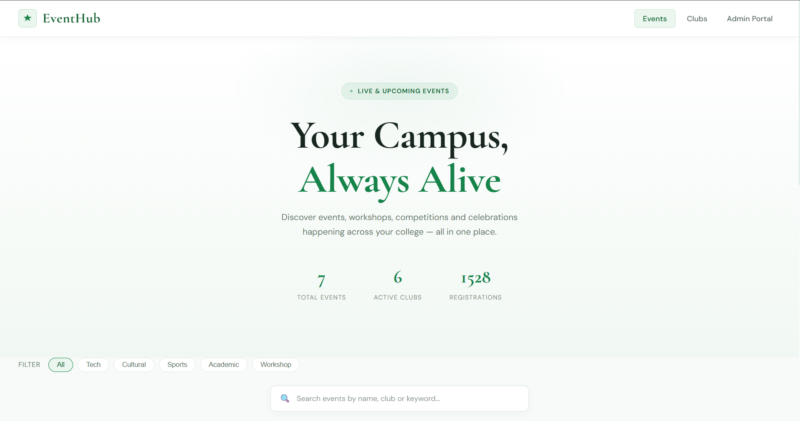
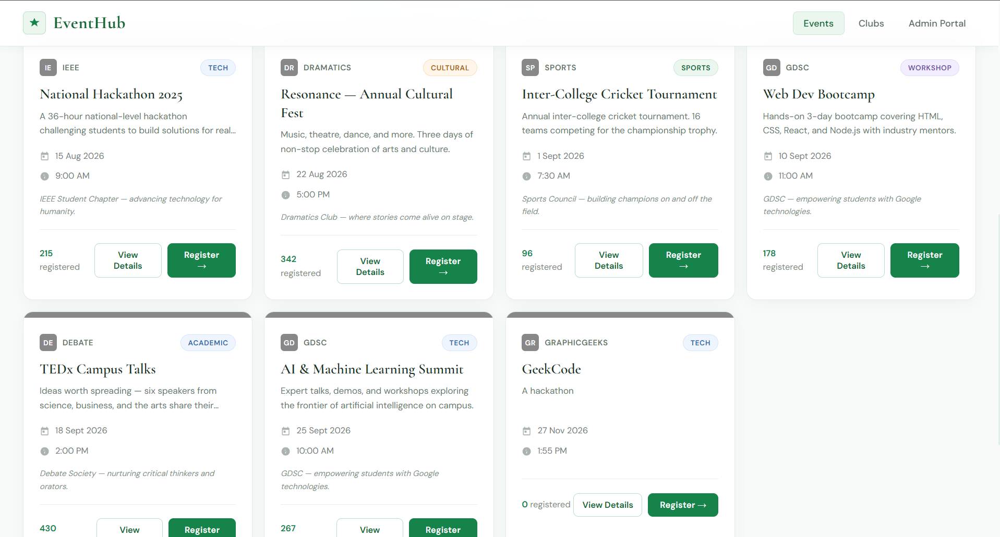
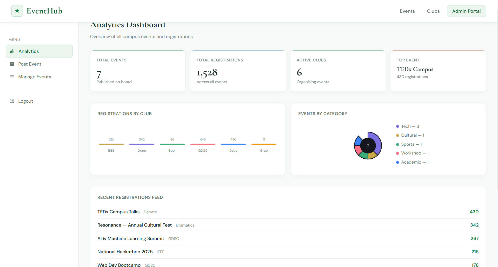
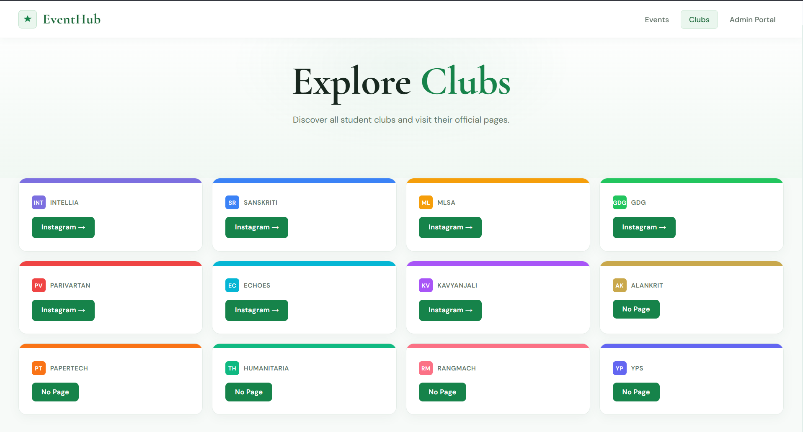

# 🎉 EventHub

**Eventhub** is a full-stack event management web application designed to provide a centralized platform for discovering, viewing, and managing college events.

The application allows users to explore available events, view event details, search and filter events, and register for events. It also provides administrative functionality for managing event information.

---

## 📌 Project Overview

College events often require information to be shared through multiple platforms, making it difficult for students to keep track of upcoming activities.

**Eventhub** provides a single platform where event information can be organized and accessed easily.

The application combines a frontend interface with a Node.js backend and MySQL database to provide a complete event management solution.

---

## ✨ Features

### 👨‍🎓 User Features

- Browse available events
- Search for events
- Filter events by category
- View detailed event information
- Register for events
- Receive registration confirmation
- Responsive and user-friendly interface

### 👨‍💼 Admin Features

- Admin login
- Add new events
- Update existing events
- Delete events
- Manage event information
- View event-related data and analytics

---

## 🛠️ Technologies Used

| Technology | Purpose |
|---|---|
| HTML5 | Structure of the web application |
| CSS3 | Styling and responsive design |
| JavaScript | Frontend functionality and interaction |
| Node.js | Backend runtime environment |
| Express.js | Server-side application framework |
| MySQL | Database management |
| Git & GitHub | Version control and project hosting |

---

## 📁 Project Structure

EventHub/
│
├── server.js
│   └── Node.js/Express backend server
│
├── package.json
│   └── Project configuration and dependencies
│
├── package-lock.json
│   └── Locked dependency versions
│
├── event.html
│   └── HTML structure and JavaScript functionality
│
└── style1.css
    └── Website styling and responsive design

---

## 🔄 How EventHub Works

User
  │
  ▼
EventHub Website
  │
  ├── Browse Events
  ├── Search Events
  ├── Filter Events
  ├── View Event Details
  └── Register for Events
          │
          ▼
     Node.js / Express
          │
          ▼
        MySQL

The frontend communicates with the Node.js backend, which handles server-side operations and database interaction.

---

## ⚙️ Installation & Setup

### 1. Clone the repository

```bash
git clone https://github.com/Aditi-35/Eventhub.git
```

### 2. Open the project folder

```bash
cd Eventhub
```

### 3. Install dependencies

```bash
npm install
```

### 4. Configure the database

Make sure MySQL is installed and running.

Create the required EventHub database and configure the database credentials used by the application.

If your project uses environment variables, create a `.env` file containing your local database configuration.

**Do not upload `.env` or database passwords to GitHub.**

### 5. Start the server

```bash
node server.js
```

When the server starts successfully, you should see a message similar to:

```text
MySQL Database Connected Successfully!
EventHub server is running!
```

### 6. Open the application

Open your browser and visit:

```text
http://localhost:3000
```

---

## 🗄️ Database

EventHub uses **MySQL** to store and manage application data.

The database is used for persistent storage of information required by the event management system.

The Node.js/Express backend handles communication between the web application and the MySQL database.

---

## 📸 Screenshots

Screenshots of the application can be added below.

### 🏠 Home Page


### 📅 Events


### 👨‍💼 Admin Dashboard


### 📝 Event Registration


### 🏠 Clubs Page


---

## 🚀 Future Enhancements

Some possible improvements for future versions include:

- User authentication and individual profiles
- Email notifications
- Event reminders
- QR-code based registration
- Advanced analytics
- Online event participation
- Mobile application
- Cloud deployment
- Enhanced security and authorization

---

## 🎓 Academic Project

**Project:** EventHub  
**Project Type:** College Mini Project  
**Domain:** Web Development / Event Management  
**Course:** B.Tech Computer Science and Engineering

---

## 📄 License

This project is developed for educational purposes.
